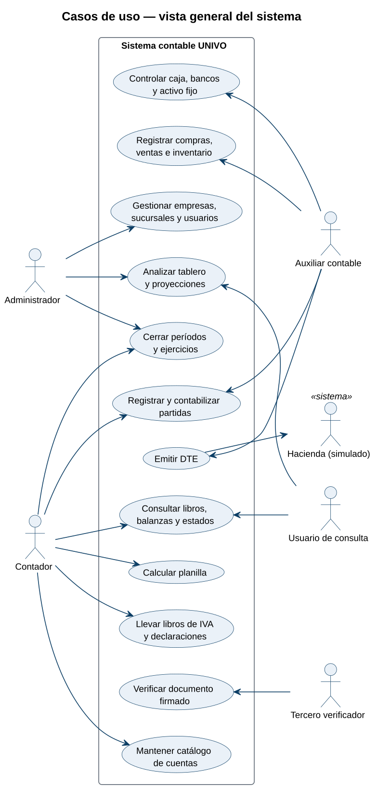
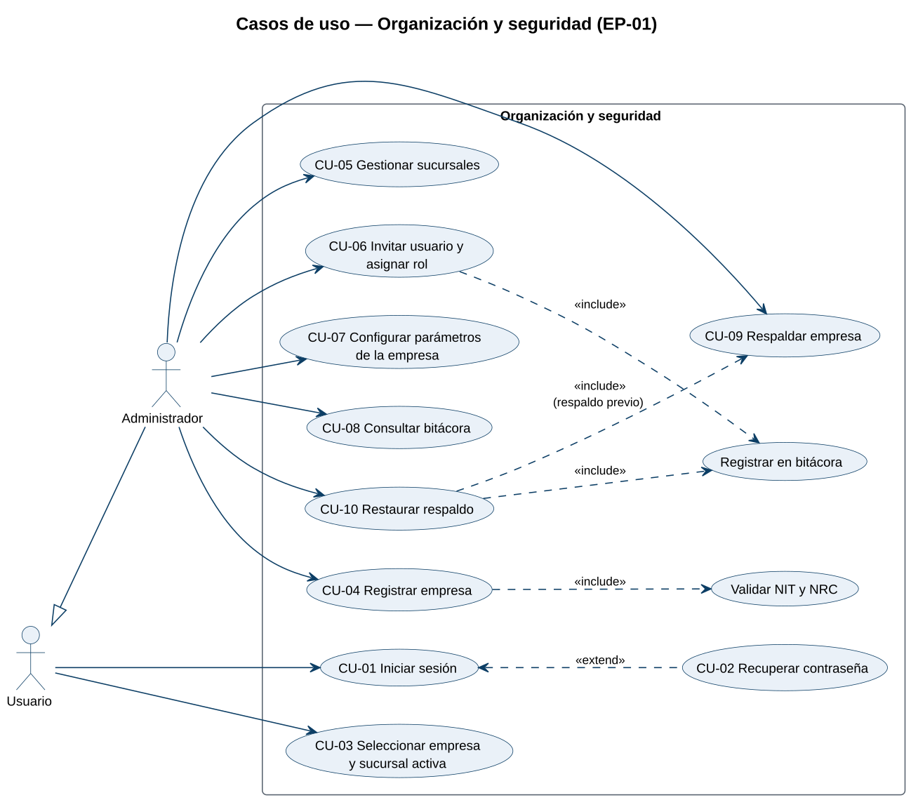
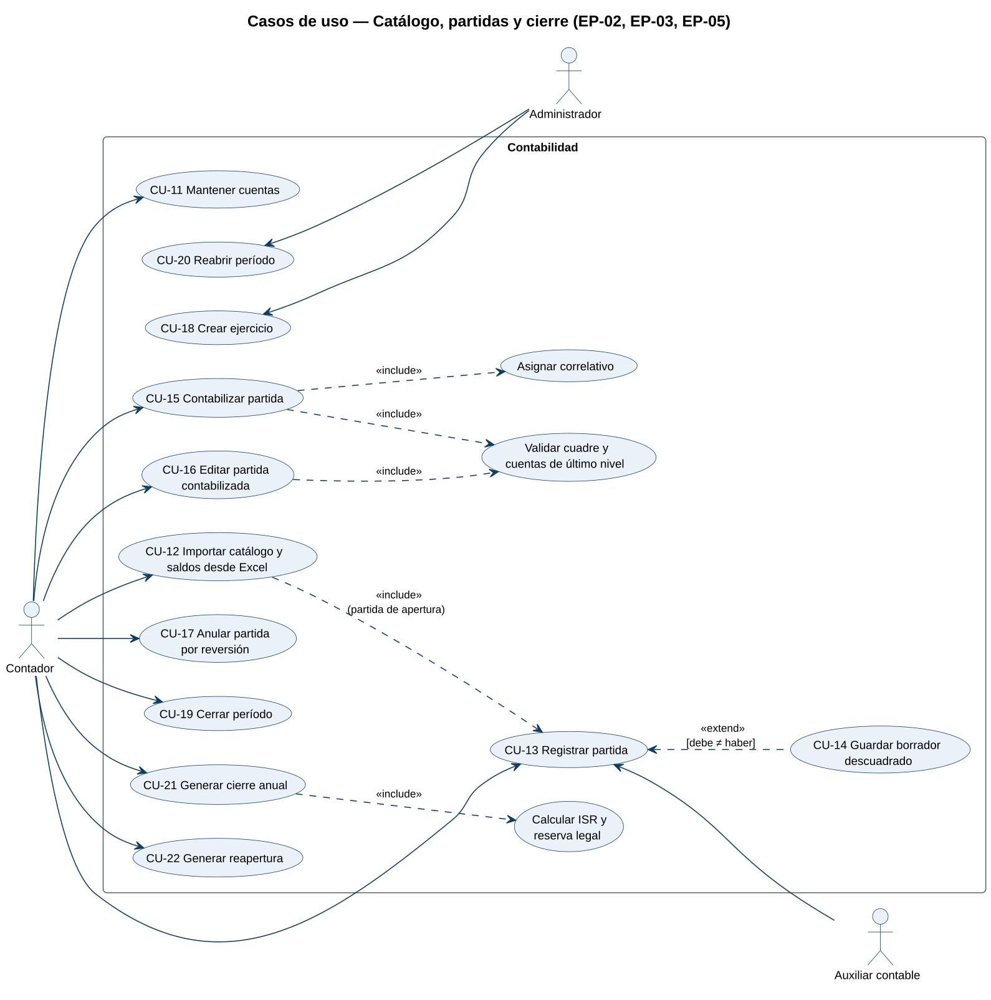
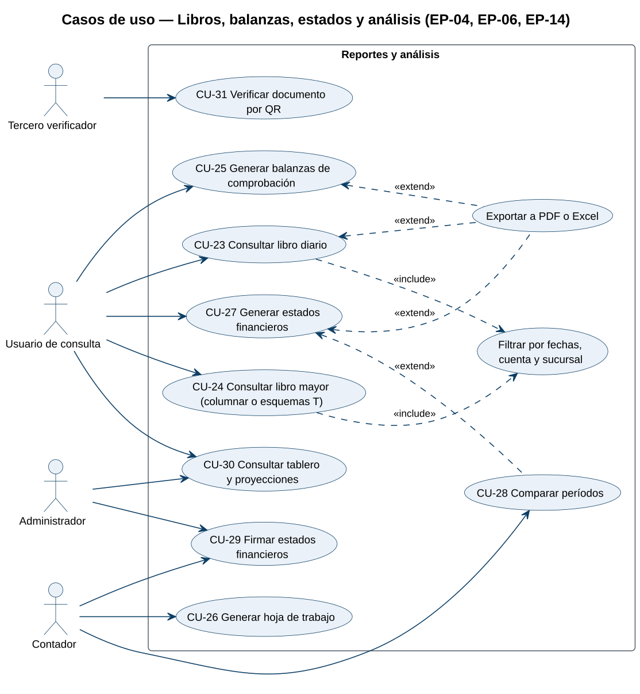
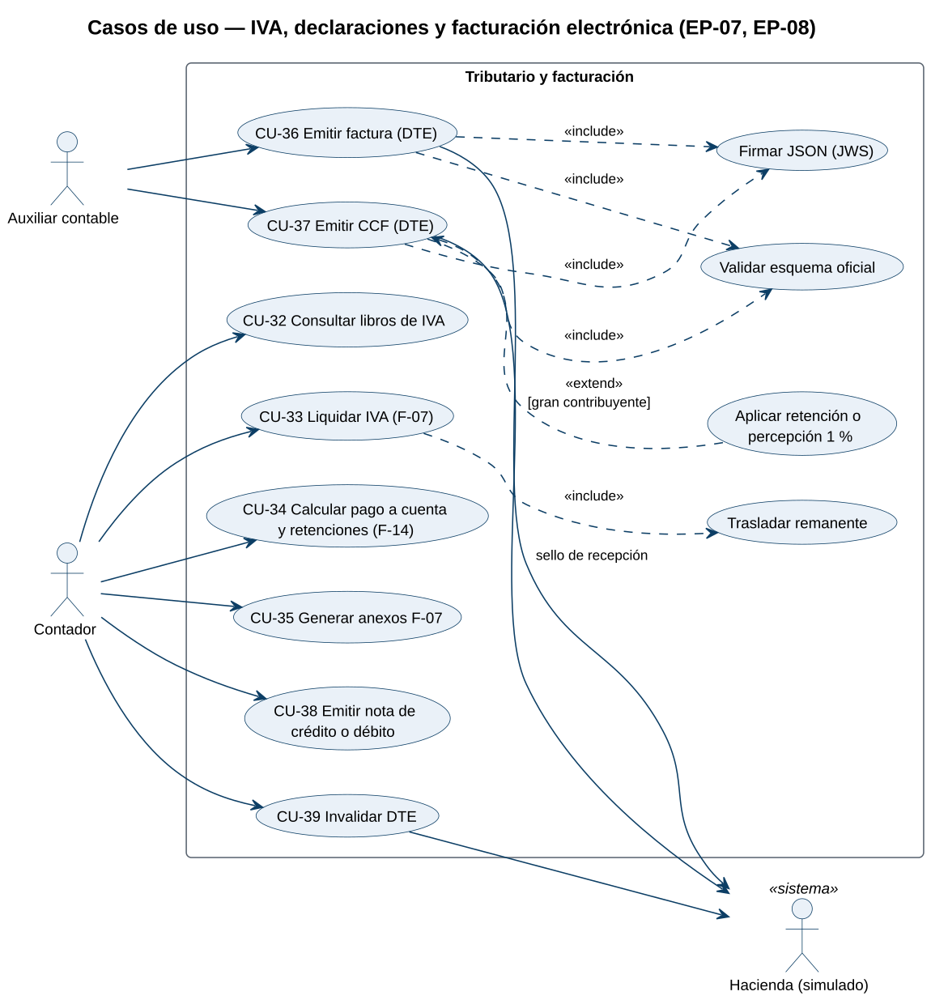
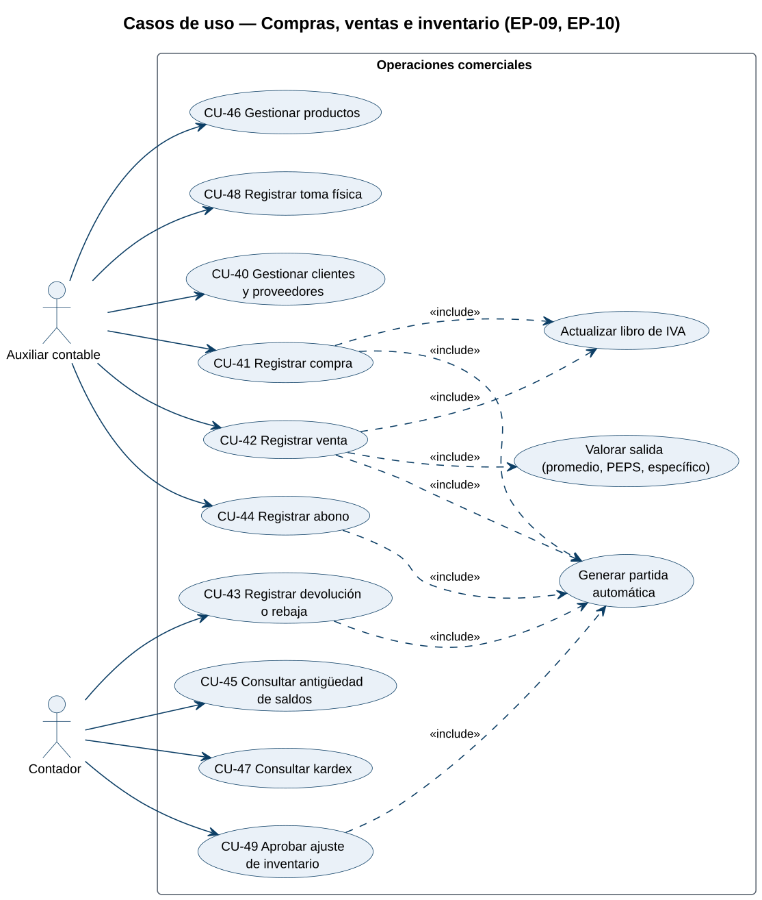
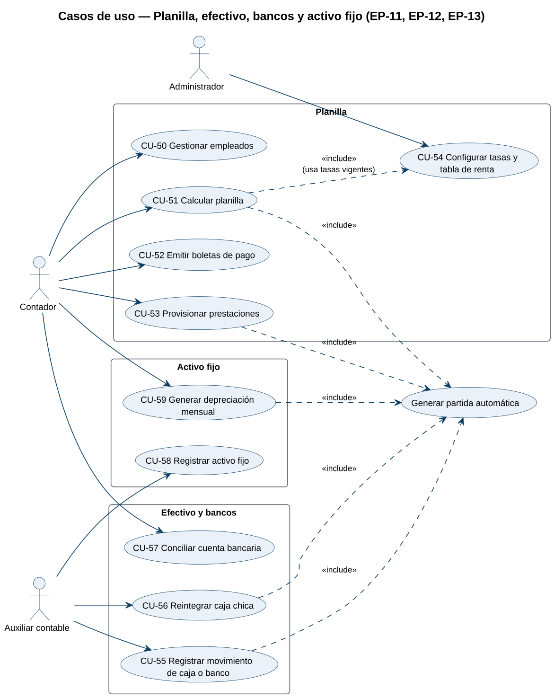

# Requerimientos

- [Levantamiento de requerimientos (PDF)](Levantamiento_de_Requerimientos.pdf): respuestas del docente, alcance por niveles, arquitectura, matriz de permisos y acuerdos.
- [Casos de uso (PDF)](Casos_de_Uso.pdf): diagramas y catálogo con trazabilidad a las historias de usuario.
- Especificación de requisitos según IEEE 830: pendiente.

# Casos de uso

## Actores

| Actor | Descripción |
|---|---|
| Administrador | Responsable de la empresa en el sistema. Configura empresas, sucursales, usuarios y parámetros, y es el único que reabre períodos y restaura respaldos. |
| Contador | Responsable de la contabilidad. Mantiene el catálogo, contabiliza, genera ajustes, cierres y declaraciones, y firma los estados financieros. |
| Auxiliar contable | Registra la operación diaria: partidas en borrador, compras, ventas, inventario, caja y bancos. |
| Usuario de consulta | Revisa libros, balanzas, estados y el tablero sin modificar información. |
| Usuario | Generalización de todos los anteriores: inicia sesión y elige la empresa y la sucursal con la que trabaja. |
| Tercero verificador | Persona externa que recibe un documento firmado y comprueba su autenticidad mediante el código QR. |
| Hacienda (simulado) | Sistema externo que recibe los DTE y devuelve el sello de recepción; en el proyecto se simula. |

## Diagramas de casos de uso

### Vista general

Resume las grandes funciones del sistema y qué actor participa en cada una. Los actores principales (administrador y contador) aparecen a la izquierda; los secundarios y los sistemas externos, a la derecha.

### Organización y seguridad

Todo usuario inicia sesión y elige su empresa activa; el administrador gestiona la empresa, sus sucursales, los usuarios y los respaldos. Restaurar un respaldo incluye generar uno previo y queda en la bitácora.

### Catálogo, partidas y cierre

El auxiliar registra partidas; si no cuadran, se guardan como borrador. El contador las contabiliza (validación de cuadre y asignación del correlativo), las edita o anula, y ejecuta los cierres. Solo el administrador crea ejercicios y reabre períodos.

### Libros, balanzas, estados y análisis

Los reportes se pueden filtrar y exportar a PDF o Excel. El contador y el administrador firman los estados financieros, y cualquier tercero puede verificarlos con el código QR.

### IVA, declaraciones y facturación electrónica

La emisión de DTE incluye la validación contra el esquema oficial y la firma JWS; la retención o percepción del 1 % se aplica cuando corresponde. La liquidación de IVA traslada el remanente al mes siguiente.

### Compras, ventas e inventario

Cada compra y venta actualiza el libro de IVA y genera su partida automáticamente; la venta además valora la salida de inventario según el método de la empresa.

### Planilla, efectivo, bancos y activo fijo

Planilla, movimientos de caja y bancos, reintegros de caja chica y depreciación generan sus partidas a través del servicio de contabilización.

## Catálogo

| ID | Caso de uso | Actor principal | Historias |
|---|---|---|---|
| CU-01 | Iniciar sesión | Usuario | HU-05 |
| CU-02 | Recuperar contraseña | Usuario | HU-05 |
| CU-03 | Seleccionar empresa y sucursal activa | Usuario | HU-09 |
| CU-04 | Registrar empresa | Administrador | HU-06 |
| CU-05 | Gestionar sucursales | Administrador | HU-07 |
| CU-06 | Invitar usuario y asignar rol | Administrador | HU-08, HU-10 |
| CU-07 | Configurar parámetros de la empresa | Administrador | HU-12 |
| CU-08 | Consultar bitácora | Administrador | HU-11 |
| CU-09 | Respaldar empresa | Administrador | HU-13 |
| CU-10 | Restaurar respaldo | Administrador | HU-13 |
| CU-11 | Mantener cuentas | Contador | HU-15, HU-16, HU-18 |
| CU-12 | Importar catálogo y saldos desde Excel | Contador | HU-17 |
| CU-13 | Registrar partida | Auxiliar contable | HU-20 |
| CU-14 | Guardar borrador descuadrado | Auxiliar contable | HU-21 |
| CU-15 | Contabilizar partida | Contador | HU-22 |
| CU-16 | Editar partida contabilizada | Contador | HU-23 |
| CU-17 | Anular partida por reversión | Contador | HU-24 |
| CU-18 | Crear ejercicio | Administrador | HU-19 |
| CU-19 | Cerrar período | Contador | HU-32 |
| CU-20 | Reabrir período | Administrador | HU-33 |
| CU-21 | Generar cierre anual | Contador | HU-35, HU-34 |
| CU-22 | Generar reapertura | Contador | HU-36 |
| CU-23 | Consultar libro diario | Usuario de consulta | HU-25 |
| CU-24 | Consultar libro mayor | Usuario de consulta | HU-27, HU-28, HU-29 |
| CU-25 | Generar balanzas de comprobación | Usuario de consulta | HU-30 |
| CU-26 | Generar hoja de trabajo | Contador | HU-31 |
| CU-27 | Generar estados financieros | Usuario de consulta | HU-37, HU-38, HU-40, HU-41, HU-42, HU-44, HU-39 |
| CU-28 | Comparar períodos | Contador | HU-43 |
| CU-29 | Firmar estados financieros | Contador | HU-87 |
| CU-30 | Consultar tablero y proyecciones | Administrador | HU-83, HU-84, HU-85 |
| CU-31 | Verificar documento por QR | Tercero verificador | HU-88 |
| CU-32 | Consultar libros de IVA | Contador | HU-45, HU-46, HU-47 |
| CU-33 | Liquidar IVA (F-07) | Contador | HU-48 |
| CU-34 | Calcular pago a cuenta y retenciones (F-14) | Contador | HU-49 |
| CU-35 | Generar anexos F-07 | Contador | HU-51 |
| CU-36 | Emitir factura (DTE) | Auxiliar contable | HU-53, HU-56 |
| CU-37 | Emitir CCF (DTE) | Auxiliar contable | HU-54, HU-50 |
| CU-38 | Emitir nota de crédito o débito | Contador | HU-55 |
| CU-39 | Invalidar DTE | Contador | HU-57 |
| CU-40 | Gestionar clientes y proveedores | Auxiliar contable | HU-58 |
| CU-41 | Registrar compra | Auxiliar contable | HU-59 |
| CU-42 | Registrar venta | Auxiliar contable | HU-60 |
| CU-43 | Registrar devolución o rebaja | Contador | HU-61 |
| CU-44 | Registrar abono | Auxiliar contable | HU-62 |
| CU-45 | Consultar antigüedad de saldos | Contador | HU-63 |
| CU-46 | Gestionar productos | Auxiliar contable | HU-64, HU-67 |
| CU-47 | Consultar kardex | Contador | HU-65, HU-66, HU-69 |
| CU-48 | Registrar toma física | Auxiliar contable | HU-68 |
| CU-49 | Aprobar ajuste de inventario | Contador | HU-68 |
| CU-50 | Gestionar empleados | Contador | HU-70 |
| CU-51 | Calcular planilla | Contador | HU-72 |
| CU-52 | Emitir boletas de pago | Contador | HU-73, HU-75 |
| CU-53 | Provisionar prestaciones | Contador | HU-74 |
| CU-54 | Configurar tasas y tabla de renta | Administrador | HU-71 |
| CU-55 | Registrar movimiento de caja o banco | Auxiliar contable | HU-76, HU-78 |
| CU-56 | Reintegrar caja chica | Auxiliar contable | HU-77 |
| CU-57 | Conciliar cuenta bancaria | Contador | HU-79, HU-80 |
| CU-58 | Registrar activo fijo | Auxiliar contable | HU-81 |
| CU-59 | Generar depreciación mensual | Contador | HU-82 |
