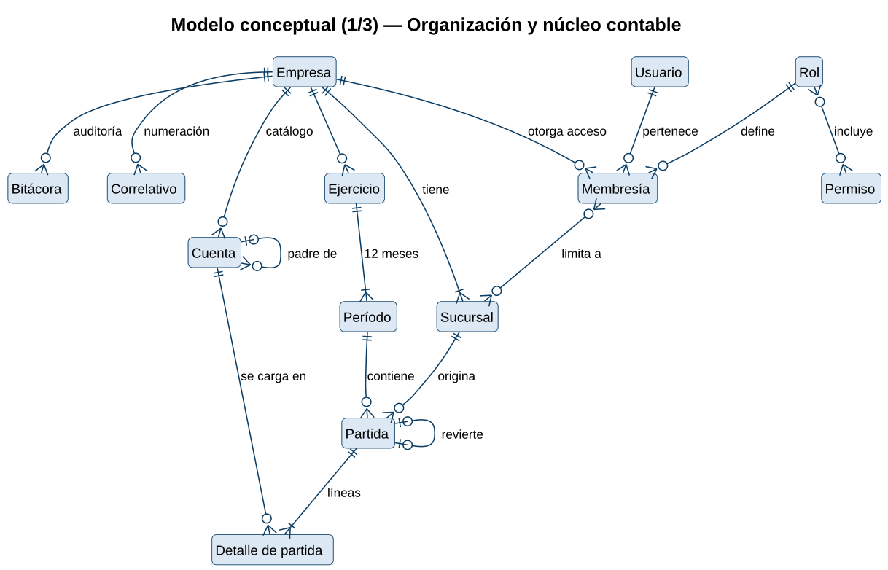
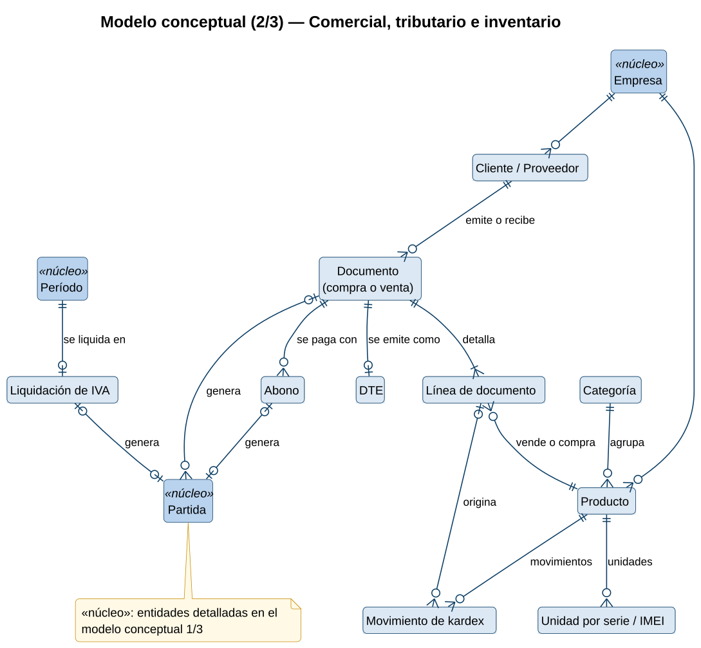
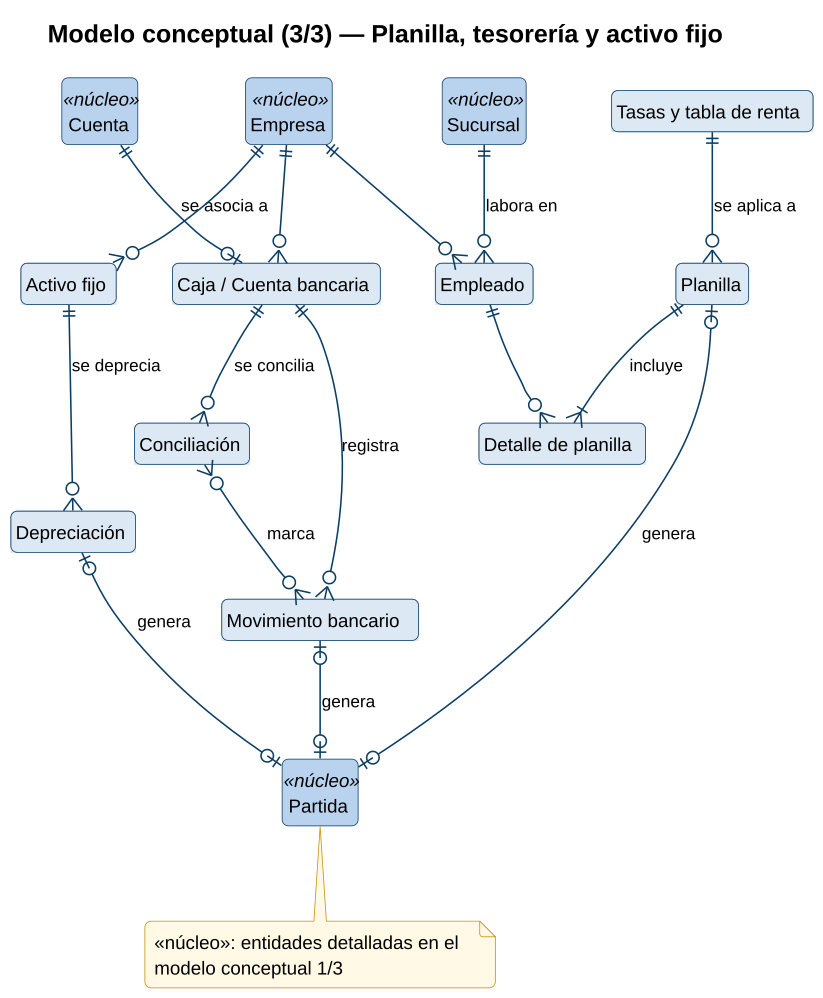
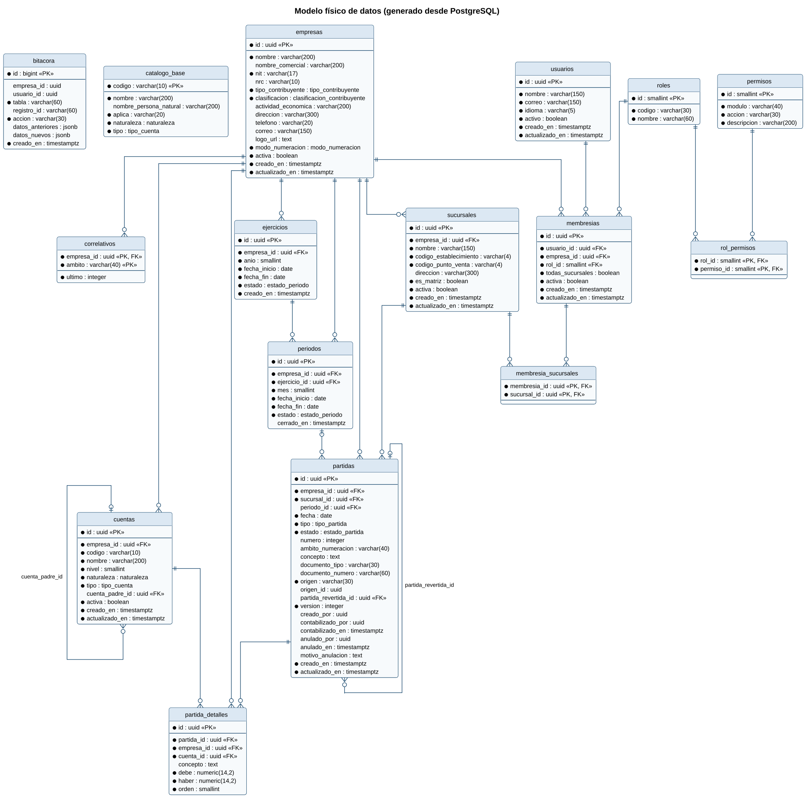

# Base de datos

- [Modelo de datos (PDF)](Modelo_de_Datos.pdf): modelos conceptual y físico, reglas y diccionario de datos.
- [Diccionario de datos](diccionario-de-datos.md) (generado desde PostgreSQL).
- Esquema: [`packages/db/prisma/schema.prisma`](../../packages/db/prisma/schema.prisma) · Migraciones: [`packages/db/prisma/migrations`](../../packages/db/prisma/migrations)
- Reglas que aplica la base y cómo probarlas: [`packages/db/README.md`](../../packages/db/README.md)

## Modelo conceptual

### Organización y núcleo contable

Entidades implementadas en el primer sprint: la organización (empresas, sucursales, usuarios, roles y permisos) y el núcleo contable (catálogo, ejercicios, períodos, partidas y bitácora).

### Comercial, tributario e inventario

Documentos de compra y venta con sus líneas, DTE, abonos, liquidación de IVA, productos y kardex. Los documentos, abonos y liquidaciones generan partidas del núcleo.

### Planilla, tesorería y activo fijo

Empleados y planillas, cuentas bancarias con sus movimientos y conciliaciones, y activos fijos con su depreciación; cada proceso genera su partida.

## Modelo físico

### Modelo físico implementado

Tablas, columnas y llaves del esquema actual en PostgreSQL 17, generado desde el catálogo de la base. Los campos marcados con asterisco son obligatorios.

